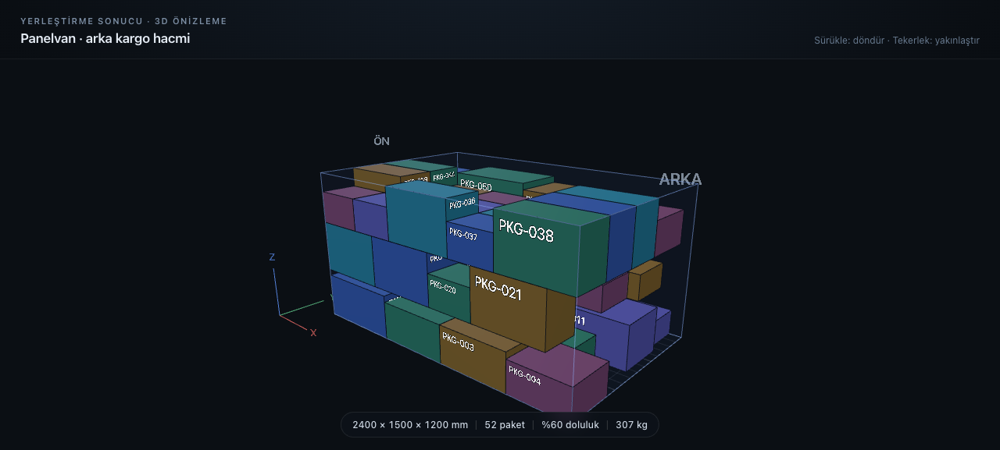

# Yerleştirme 3D — POC



Araç içi yerleştirme (packing) algoritmasının çıktısını dikdörtgenler prizmaları olarak 3D gösteren
Angular 21 + Three.js prototipi. Bileşen **standalone** ve kendi kendine yeterli; `src/app/placement-3d/`
klasörünü mevcut Angular projene kopyalayıp doğrudan kullanabilirsin.

## Çalıştırma

```bash
cd placement-3d-poc
npm install
npm start        # http://localhost:4200
npm run build    # dist/placement-3d-poc
```

## Kullanım

```html
<placement-3d-view [vehicle]="vehicle" [boxes]="boxes" />
```

| Input | Tip | Varsayılan | Açıklama |
| --- | --- | --- | --- |
| `vehicle` | `VehicleVolume` | zorunlu | Kargo alanı ölçüleri (mm) |
| `boxes` | `readonly PlacedBox[]` | zorunlu | Yerleştirilmiş paketler (mm). **Yeni dizi referansı** ver (signal/mutation değil) |
| `anchor` | `'min' \| 'center'` | `'min'` | `x/y/z` kutunun sol-ön-alt köşesi mi, merkezi mi |
| `theme` | `'dark' \| 'light'` | `'dark'` | Sahne paleti |
| `autoRotate` | `boolean` | `false` | Kamera yavaşça kendi etrafında döner |
| `showHelpers` | `boolean` | `true` | X/Y/Z işaretleri + ÖN/ARKA etiketleri |
| `showLabels` | `boolean` | `true` | Her paketin görünen yüzeyine `packageId` yazar |
| `showStats` | `boolean` | `true` | Alt bilgi satırı (ölçü, adet, doluluk, ağırlık) |

Bileşen `stats` adında bir `computed` da yayınlar (ölçü, adet, hacim, ağırlık, doluluk %) — dışarıda
tekrar hesaplamana gerek yok.

### Veri sözleşmesi

```ts
vehicle = { label: 'Panelvan', lengthMm: 2400, widthMm: 1500, heightMm: 1200 };

boxes = [
  {
    id: 'PKG-001',
    x: 0, y: 0, z: 0,                      // konum (mm)
    length: 600, width: 400, height: 300,  // ölçü (mm)
    weight: 12.4,                          // kg — opsiyonel
    color: '#5b8def',                      // opsiyonel, verilmezse palet
  },
];
```

## Koordinat sistemi

- Birim **mm**; eksenler **X = uzunluk, Y = genişlik, Z = yükseklik** (z-up).
- Orijin: kargo alanının **sol-ön-alt köşesi**, yani `x = 0` ön yüz.
- Three.js y-up/ metre kullanır. Dönüşüm **tek yerde**: `engine/coordinate.ts` içindeki kök grubun
  `rotation.x = -π/2` + `scale = 1/1000` değerleri. Mesh kodu doğrudan algoritma koordinatlarıyla
  yazıldığı için eksen çevirisi hiçbir yerde tekrarlanmaz.
- Konvansiyon değişirse sadece o iki satır değişir.
- `anchor: 'center'` verirsen `x/y/z` merkez kabul edilir; kod aynı kalır.

## Mimari

```
src/app/placement-3d/
├─ placement-3d-view.ts | .html | .scss   # Angular katmanı: input/effect, yaşam döngüsü, HUD
├─ types.ts                               # VehicleVolume, PlacedBox, BoxAnchor, SceneTheme
└─ engine/                                # Angular importu YOK — saf Three.js
   ├─ coordinate.ts                       # mm z-up → m y-up (tek nokta)
   ├─ palette.ts                          # dark/light renk ve opaklıkları
   ├─ builders.ts                         # kargo kabuğu, ızgara, kutu mesh'leri, etiketler, dispose
   └─ placement-scene.ts                  # renderer, kamera fit, ışıklar, resize, dispose
```

Teknik notlar:

- **Zoneless uyumlu**: render döngüsü `NgZone.runOutsideAngular` + `setAnimationLoop` ile Angular
  change detection'ının dışında çalışır.
- **SSR güvenli**: sahne `afterNextRender` içinde kurulur, sunucuda hiçbir WebGL çağrısı yapılmaz.
- **Temizlik**: `dispose()` tüm geometri/materyal/doku/renderer/observer kaynaklarını serbest bırakır.
- **Gölge yok, eşit aydınlatma**: `shadowMap` kapalı; yüksek ortam ışığı + üç yönlü düşük yoğunluklu
  directional ile her yüz okunur kalır (paketlerin içi/arkası karanlıkta kaybolmaz). Ton eşlemesi kapalı
  olduğu için yüzey parlaklığı öngörülebilir.
- **packageId etiketleri**: billboard DEĞİL — kutunun tek bir yüzeyine yapıştırılan düzlem. Kameranın
  baktığı yüz (üst/ön/arka/sol/sağ) seçilip etiket oraya taşınır; yazı hiçbir açıda kutunun içine
  girmez. Yazının sol-üst köşesi, yüzün sol-üst köşesine `margin` kadar içeriden çapalanır ve boyutu
  yüzeyin yazı yönlerine düşen ölçüsüyle sınırlanır — metin kendi dikdörtgeninden asla taşmaz.
  Yön 90°'lik sabit yönlere kilitlidir: kamera hafifçe dönerken yazı dönmez, ancak açı ~45° ± 12°
  eşiğini geçtiğinde diğer yöne atlar (histerezis). Yüz seçiminde de %12'lik histerezis vardır.
- **Ölçek**: 2000+ pakette `builders.buildBoxObject` yerine `InstancedMesh` + birleşik `LineSegments`
  kullanılmalı; sahne kurulumu tek yerde olduğu için değişiklik lokal kalır.

## Örnek veri

`src/app/core/sample-data.ts` sabit seed'li bir LCG ile katman → sıra → paket sırasıyla yerleştirme üretir.
Aynı seed her zaman aynı görüntüyü verir (ekran görüntüsü/karşılaştırma için). Paket ölçüleri gerçekçi
e-ticaret katalogundan, ağırlık hacim × yoğunluk ile türetilir.

## Kapsam dışı (bilinçli)

- Hover/click ile seçim ve detay paneli (`mesh.userData['boxId']` picking için hazır)
- Z-katman filtresi / dilim görünümü
- Sıralı yerleşme animasyonu
- Gerçek araç içi GLB modeli
- Ağırlık merkezi / denge analizi
